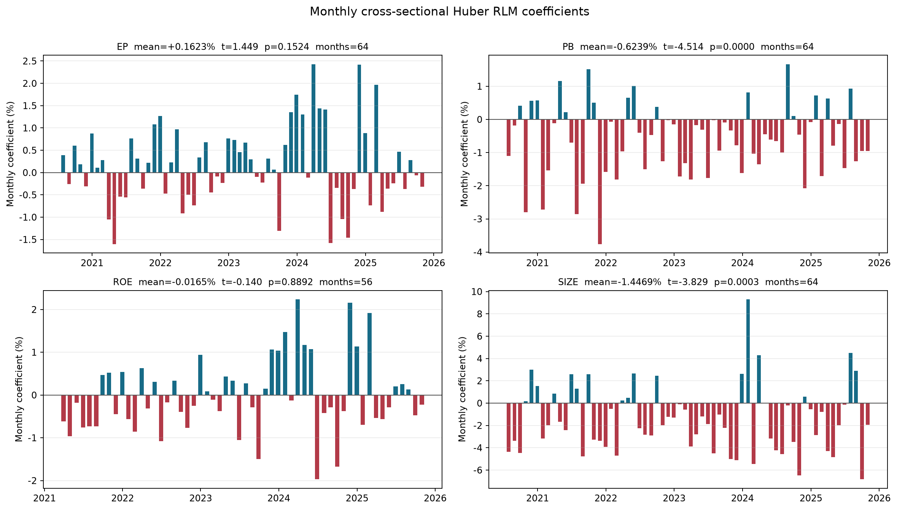
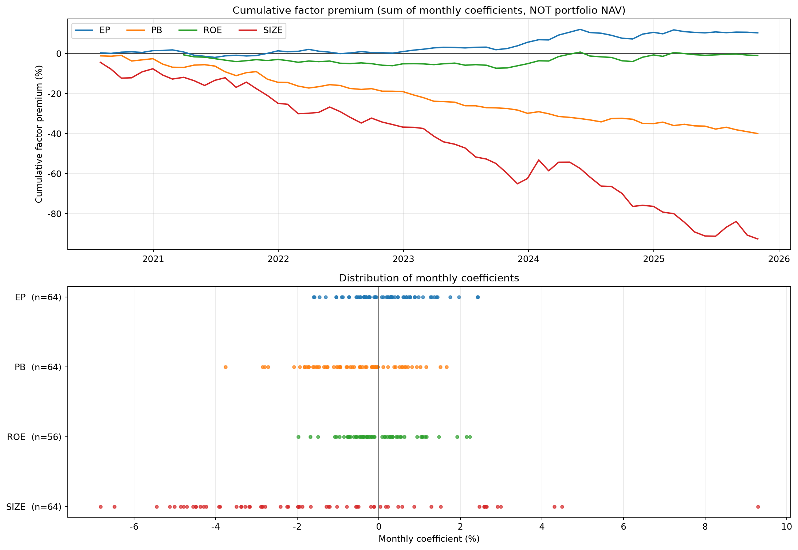
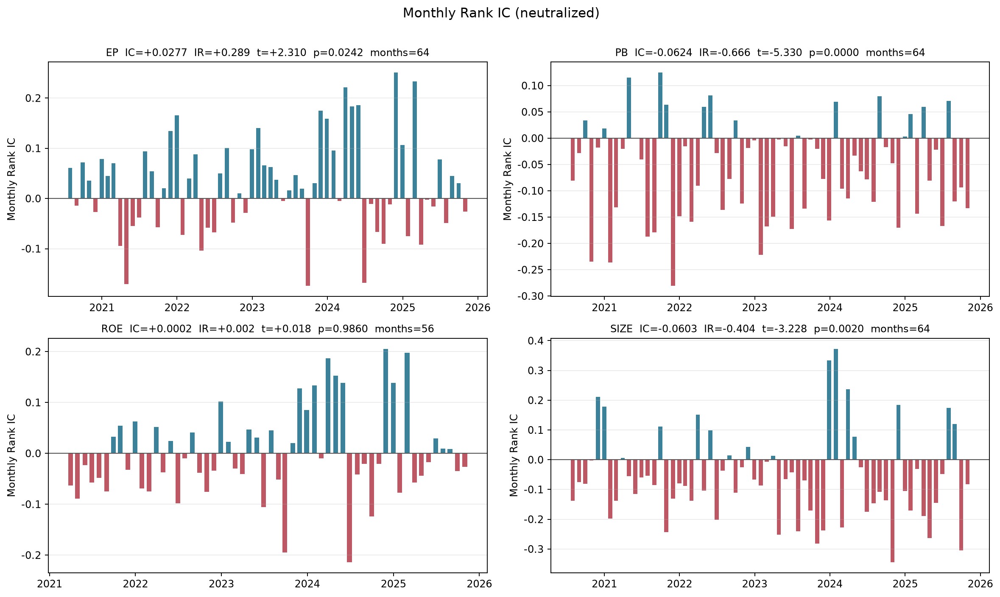
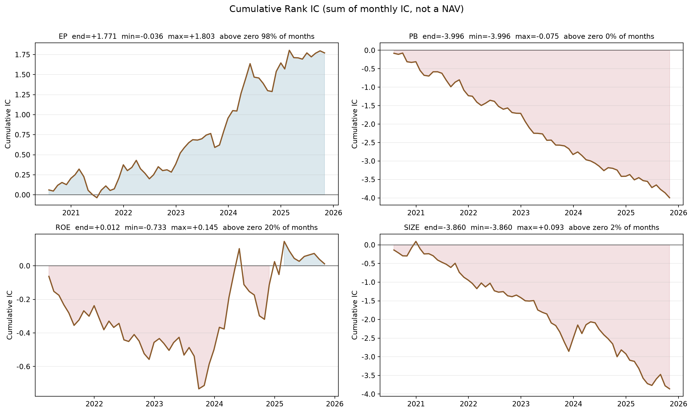
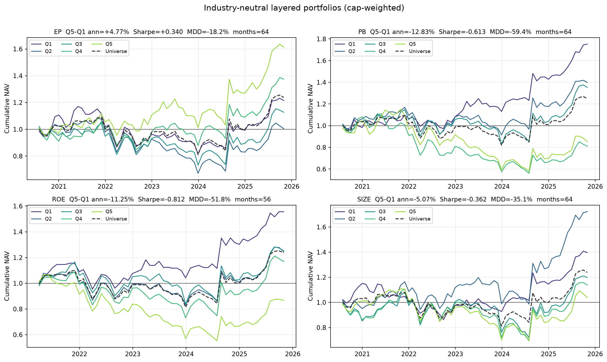

# 因子测试

此处测试对EP、PB、ROE、SIZE按照文档EP/PE 统计分析与因子测试计划做了1.因子的横截面回归2.计算因子的IC值3.分层回测
测试，主要目的是检验因子的方向，可用性等问题

## 一、测试口径

### 1.1 样本与收益口径（所有检验共用）

- 每月最后一个交易日形成因子，次月第一个交易日按复权收盘价建仓，再下月首个交易日退出；
- 前瞻收益为建仓日与退出日复权收盘价之比减一，任一端点停牌则置为缺失；
- 股票池为沪深 A 股 + 北交所；
- 控制变量为「形成日横截面标准化的对数总市值」加 `K−1` 个申万一级行业哑变量；
- 单月观测数低于 500 的月份跳过并记录，因此各因子的月份数可能不同。

### 1.2 各检验的分工

| 检验 | 回答的问题 | 强项 | 盲点 |
|---|---|---|---|
| 横截面回归 | 因子每高一个单位，收益平均变化多少 | 有经济单位的因子溢价 | 假设线性；受极值影响；系数显著≠能挣钱 |
| Rank IC | 因子的排序和收益的排序是否一致、是否稳定 | 无量纲、可跨因子比 | 只看排序不含强度；IC 显著≠组合收益高 |
 分层回测                                    如果真按照因子的大小进行组合建仓，真实的年化收益
                                  波动回撤怎么反应较  
  ## 二、横截面回归（Huber RLM）   

### 2.1 回归口径

- 模型：`r_fwd = α + β_F · F_Z + β_Size · Size_Z + K−1 个行业哑变量 + ε`；
- 估计：`HuberT(c=1.345)`、MAD 残差尺度、H1 稳健协方差，最多 100 次迭代、`1e-8` 收敛；
- 单月显著性用 H1 标准误计算的大样本 `z` 值；全期显著性用月度系数的独立同方差 `t` 检验；
- 月均系数可解释为「因子每高一个横截面标准差，下一持有期收益的平均变化」。

### 2.2 全期结果

| 因子 |  | 月均系数 | 中位数 | 标准差 | IID 标准误 | IID t 值 | IID p 值 | 正系数比例 | 单月 abs(z)>=2 比例 | 平均 R² |  |
|---|---:|---:|---:|---:|---:|---:|---:|---:|---:|---:|---:|
| **EP** |  | +0.1623% | +0.1465% | +0.8964% | +0.1120% | +1.449 | 0.1524 | 53.12% | 82.81% | 12.22% | 
| **PB** |  | -0.6239% | -0.5364% | +1.1057% | +0.1382% | -4.514 | 0.0000 | 25.00% | 81.25% | 12.33% | 
| **ROE** |  | -0.0165% | -0.2018% | +0.8814% | +0.1178% | -0.140 | 0.8892 | 42.86% | 80.36% | 13.00% |  |
| **SIZE** |  | -1.4469% | -1.9611% | +3.0230% | +0.3779% | -3.829 | 0.0003 | 28.12% | 70.31% | 11.76% |  |

### 2.4 图

上半部分是各因子月度系数的**累加**，下半部分是月度系数的分布。

> 累计溢价是月度系数的累加和，**不是组合净值**，不能当作可交易收益。

## 三、Rank IC 检验

### 3.1 检验口径

- 每月形成日把标准化因子对「标准化对数市值 + K−1 个行业哑变量」做横截面 OLS，取残差作为**中性化暴露**；
- `IC_t = Spearman(中性化暴露, 下一持有期收益)`，`IR = mean(IC) / std(IC)`；
- 同时报告**未中性化**的原始 IC 作为对照；
- 显著性用 `t = IR × √月数` 判断。

### 3.2 全期结果

| 因子 |  | 中性化 IC 均值 | IC 标准差 | IR | IC 的 t 值 | IC 的 p 值 | IC>0 比例 | abs(IC)>0.02 比例 | 原始 IC 均值 | 原始 IR |  |
|---|---:|---:|---:|---:|---:|---:|---:|---:|---:|---:|---:|
| **EP** |  | +0.0277 | 0.0958 | +0.289 | +2.310 | 0.0242 | 57.81% | 84.38% | +0.0189 | +0.132 |  |
| **PB** |  | -0.0624 | 0.0937 | -0.666 | -5.330 | 0.0000 | 25.00% | 81.25% | -0.0809 | -0.502 | 
| **ROE** |  | +0.0002 | 0.0890 | +0.002 | +0.018 | 0.9860 | 42.86% | 91.07% | -0.0227 | -0.165 | 
| **SIZE** |  | -0.0603 | 0.1495 | -0.404 | -3.228 | 0.0020 | 25.00% | 92.19% | -0.0684 | -0.381 |  |

IR =IC均值/IC标准差 是月频指标、未年化。对比「中性化 IC」与「原始 IC」可以判断中性化是否有帮助，衡量的是IC值预测的稳定性。

### 3.4 图

每格是该因子的逐月中性化 IC。蓝柱为正向月份、红柱为负向月份，正负交替越多说明单月估计越不稳定。

每格是该因子的**累计 IC**（逐月 IC 的累加）。线条的斜率就是当月 IC：向上说明该月为正向、向下说明为负向；曲线的整体走向反映因子方向。

## 四、行业内分层回测

### 4.1 回测口径

- **分组依据**：因子对「对数市值 + 行业」回归后的中性化残差，与 Rank IC 口径一致；
- **分组方式**：每月在每个申万一级行业内部按残差升序分五组，Q1 最低、Q5 最高；各行业同序号组合并成全市场组合，因此每个组合的行业构成与股票池一致；
- **权重**：组合市值加权，权重在形成日确定，持有期内不调仓；
- **可交易性**：建仓日涨停（买不进）与退出日跌停（卖不出）的股票均剔除；
- **多空组合**：`Q5 − Q1`，零成本对冲；
- **基准**：股票池市值加权收益；
- **不含交易成本**。多空组合在 A 股还受融券可行性限制，实务上更可用的是最高组相对基准的超额。

### 4.2 组合绩效

按因子拆成四张表，每张表是该因子的五个分位组合与多空组合。

**EP**

| 组合 | 年化收益 | 累计收益 | 年化波动 | 夏普比率 | 最大回撤 | 胜率 | 年化超额 | 信息比率 | 平均换手率 |
|---|---:|---:|---:|---:|---:|---:|---:|---:|---:|
| Q1 | +3.72% | +21.52% | 17.97% | +0.207 | -30.11% | 51.56% | -0.43% | -0.064 | 12.46% |
| Q2 | +0.09% | +0.46% | 21.64% | +0.004 | -37.83% | 43.75% | -3.40% | -0.731 | 25.32% |
| Q3 | +2.28% | +12.75% | 21.40% | +0.106 | -29.89% | 50.00% | -1.26% | -0.235 | 32.85% |
| Q4 | +6.16% | +37.53% | 18.95% | +0.325 | -19.64% | 53.12% | +2.04% | +0.272 | 30.20% |
| Q5 | +9.38% | +61.30% | 20.20% | +0.464 | -17.36% | 53.12% | +5.21% | +0.636 | 17.75% |
| **Q5-Q1** | **+4.77%** | **+28.19%** | 14.02% | **+0.340** | **-18.19%** | **56.25%** | +0.02% | +0.001 | 15.11% |

**PB**

| 组合 | 年化收益 | 累计收益 | 年化波动 | 夏普比率 | 最大回撤 | 胜率 | 年化超额 | 信息比率 | 平均换手率 |
|---|---:|---:|---:|---:|---:|---:|---:|---:|---:|
| Q1 | +11.09% | +75.25% | 14.45% | +0.768 | -11.11% | 57.81% | +5.80% | +0.560 | 9.80% |
| Q2 | +6.51% | +39.96% | 19.22% | +0.339 | -21.87% | 53.12% | +2.27% | +0.443 | 27.15% |
| Q3 | +5.83% | +35.31% | 21.08% | +0.277 | -27.79% | 53.12% | +2.01% | +0.399 | 33.44% |
| Q4 | -3.86% | -18.94% | 22.98% | -0.168 | -49.47% | 46.88% | -7.19% | -0.831 | 27.88% |
| Q5 | -2.95% | -14.74% | 25.74% | -0.114 | -49.69% | 43.75% | -5.71% | -0.510 | 17.71% |
| **Q5-Q1** | **-12.83%** | **-51.91%** | 20.94% | **-0.613** | **-59.35%** | **42.19%** | -17.26% | -0.939 | 13.76% |

**ROE**

| 组合 | 年化收益 | 累计收益 | 年化波动 | 夏普比率 | 最大回撤 | 胜率 | 年化超额 | 信息比率 | 平均换手率 |
|---|---:|---:|---:|---:|---:|---:|---:|---:|---:|
| Q1 | +9.93% | +55.56% | 15.64% | +0.635 | -17.46% | 58.93% | +4.34% | +0.584 | 13.23% |
| Q2 | +4.80% | +24.46% | 19.51% | +0.246 | -23.40% | 50.00% | +0.14% | +0.045 | 20.88% |
| Q3 | +4.93% | +25.18% | 22.13% | +0.223 | -28.15% | 53.57% | +0.76% | +0.180 | 24.75% |
| Q4 | +3.41% | +16.93% | 23.81% | +0.143 | -32.79% | 46.43% | -0.40% | -0.067 | 24.61% |
| Q5 | -3.01% | -13.28% | 24.69% | -0.122 | -48.23% | 48.21% | -6.58% | -0.939 | 14.57% |
| **Q5-Q1** | **-11.25%** | **-42.70%** | 13.86% | **-0.812** | **-51.82%** | **37.50%** | -17.24% | -1.205 | 13.90% |

**SIZE**

| 组合 | 年化收益 | 累计收益 | 年化波动 | 夏普比率 | 最大回撤 | 胜率 | 年化超额 | 信息比率 | 平均换手率 |
|---|---:|---:|---:|---:|---:|---:|---:|---:|---:|
| Q1 | +6.46% | +39.66% | 15.05% | +0.429 | -25.04% | 51.56% | +1.77% | +0.212 | 6.37% |
| Q2 | +10.74% | +72.31% | 21.00% | +0.512 | -18.99% | 57.81% | +6.70% | +0.841 | 24.74% |
| Q3 | +3.45% | +19.85% | 24.67% | +0.140 | -33.21% | 50.00% | +0.70% | +0.064 | 28.78% |
| Q4 | +2.47% | +13.88% | 25.25% | +0.098 | -37.29% | 51.56% | -0.18% | -0.018 | 22.61% |
| Q5 | +0.71% | +3.86% | 22.94% | +0.031 | -37.10% | 50.00% | -2.46% | -0.390 | 10.59% |
| **Q5-Q1** | **-5.07%** | **-24.23%** | 14.01% | **-0.362** | **-35.14%** | **42.19%** | -9.80% | -0.689 | 8.48% |

「年化超额」「信息比率」是相对股票池市值加权基准的多头超额；多空组合是零成本对冲组合，与多头基准比较没有经济含义，该行只看年化收益、夏普比率与最大回撤。

### 4.3 分年度多空收益

| 因子 | 2020 | 2021 | 2022 | 2023 | 2024 | 2025 |
|---|---:|---:|---:|---:|---:|---:|
| **EP** | -13.71% | +15.43% | +9.29% | +7.93% | +5.40% | +3.51% |
| **PB** | +4.17% | -16.14% | -6.18% | -38.47% | -4.42% | -0.22% |
| **ROE** | - | -16.40% | -6.41% | -30.10% | -3.87% | +8.99% |
| **SIZE** | -12.31% | +13.29% | -1.68% | -23.30% | +0.32% | +0.81% |

### 4.4 图

## 五、三个检验的对照

三个检验用的是同一套样本与收益，但角度不同：回归看数值、IC 看排序、分层回测看落到组合上的结果。**方向是否一致本身就是信息。**

| 因子 | 回归月均系数 | IC 均值 | 多空年化收益 | 方向是否一致 |
|---|---:|---:|---:|---|
| **EP** | +0.1623% | +0.0277 | +4.77% | 一致 |
| **PB** | -0.6239% | -0.0624 | -12.83% | 一致 |
| **ROE** | -0.0165% | +0.0002 | -11.25% | **不一致** |
| **SIZE** | -1.4469% | -0.0603 | -5.07% | 一致 |

三个方向一致，说明「线性幅度」「排序信息」「组合可实现性」互相印证；不一致说明因子的信息分布特殊（例如只有两端有区分度），需要人工判断，不宜直接使用。

## 六、结论

### 6.1 三个检验的结果

| 因子 | 回归月均系数 | IC 均值 | 多空年化 | 三项方向 | 显著性 |
|---|---:|---:|---:|---|---|
| **PB** | -0.6239% | -0.0624 | -12.83% | 一致 | 回归与 IC 均显著 |
| **SIZE** | -1.4469% | -0.0603 | -5.07% | 一致 | 回归与 IC 均显著 |
| **EP** | +0.1623% | +0.0277 | +4.77% | 一致 | IC 显著，回归不显著 |
| **ROE** | -0.0165% | +0.0002 | -11.25% | **不一致** | 均不显著 |

### 6.2 结论

1. **PB 最强**：回归与 IC 都显著，六年方向从不翻转。反向后（`BP = 1/PB`）是四个因子里最干净的一个。
2. **SIZE 次之**：统计上显著，但 IC 波动最大（标准差 0.1495），收益集中在少数月份。
3. **EP 偏弱**：IC 显著而回归不显著，正向只靠 2023—2024 两年撑起来，多空夏普仅 0.34。
4. **ROE 不可用**：从横截面回归和IC测试看不出来ROE因子的明显方向，而 在分层回测中因子表现出了明显的负相关，考虑到市值加权的影响，可能是大盘低ROE跑赢了小盘高ROE成长股的原因。

